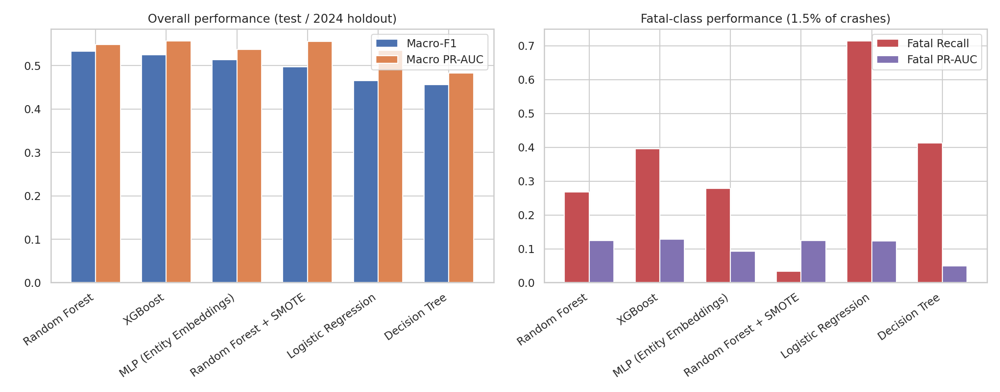
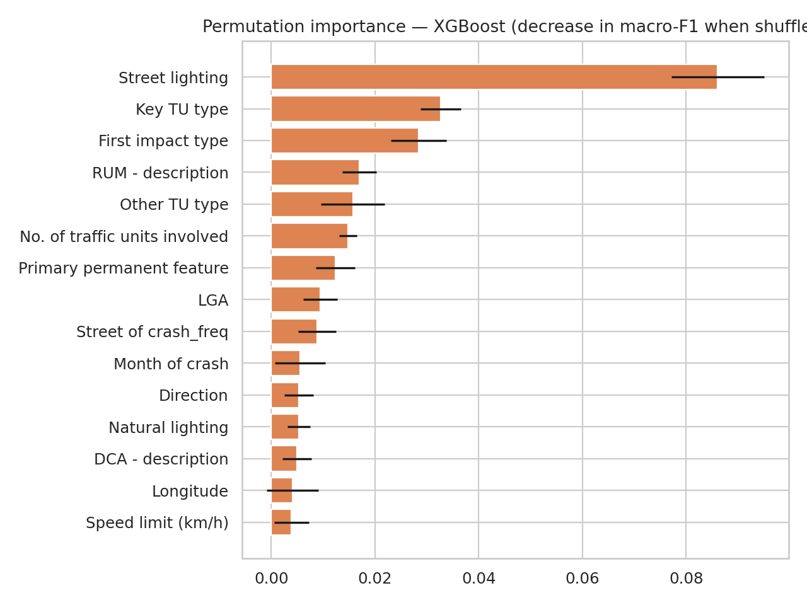

# NSW Crash Risk Console: GIS + Machine Learning

An interactive decision-support dashboard for road-crash severity in New South Wales, built on
**92,082 Transport for NSW crash records (2020–2024)**. It has risk maps by local government area (LGA),
a fatal-risk model you can inspect and retrain in the browser, and a scenario scorer for "what if" road conditions.

🏆 **Team Winner, MIT IMPACT (Industry MIT Project and Communication Tracks) event, 1 October 2026.**
This was an industry capstone with **BAOAN Australia** for the Bachelor of Data Analytics at Melbourne
Institute of Technology, Sydney. I led the machine learning workstream.

### ▶ [Open the live dashboard](https://kusalzkunwar-ml.github.io/nsw-road-crash-dashboard/)

## What it shows

- **Crash patterns:** severity mix, fatality rate by speed zone, trends by year, month, day and hour, weather,
  vehicle type, crash configuration and first impact.
- **Map:** 9,400 sampled crashes plotted with Leaflet, plus the highest-risk LGAs ranked by model-predicted fatal risk.
- **The model:** odds multipliers per feature, ROC curve, a threshold slider showing the recall/precision trade-off,
  a model comparison, and a depth-3 decision tree written out as rules.
- **Retrain it live:** an Adam optimiser fits the logistic regression in your browser tab over the sampled crashes.
- **Scenario scoring:** pick a speed zone, weather, vehicle, lighting and location, and see the predicted fatal risk and what drives it.

## Key findings

- Fatal risk climbs with speed: 0.8% of crashes are fatal in zones up to 50 km/h, rising to **4.0% at 100 km/h and over**.
- **Unlit roads at high speed are the deadliest combination.** At 100 km/h and over, 6.9% of crashes with no street lighting are fatal, against 3.4% where lighting is on.
- Motorcycles, bicycles/scooters and heavy vehicles raise the odds of a fatal outcome the most.
- The highest predicted risk is in rural LGAs with high average speed zones, such as Upper Lachlan, Warrumbungle and Greater Hume.

## The machine learning behind it

The full analysis is in [`notebook/crash_severity_modelling.ipynb`](notebook/crash_severity_modelling.ipynb)
(EDA through to modelling, with outputs), documented in the [model card](model/MODEL_CARD.md).

**Task:** classify each crash as Fatal, Injury or Non-casualty. Fatal crashes are only 1.5% of the data, so
models are judged on macro-F1 and PR-AUC, not accuracy. Always predicting "Injury" would score 66% accuracy
and never find a single fatal crash.

**Set-up:**
- Split by year (train 2020–2022, validate 2023, test on untouched 2024) so the test mimics predicting next year.
- Outcome columns such as "No. killed" were removed as leakage.
- Class imbalance was handled with balanced class weights. SMOTE was tried and rejected because it cut fatal
  recall from 0.27 to 0.03.

| Model (2024 holdout) | Macro-F1 | Macro ROC-AUC | Fatal recall | Fatal precision |
|---|---:|---:|---:|---:|
| **Random Forest** (selected) | **0.534** | 0.826 | 0.27 | 0.13 |
| XGBoost | 0.525 | 0.831 | 0.40 | 0.11 |
| MLP with entity embeddings | 0.514 | 0.799 | 0.28 | 0.11 |
| Random Forest + SMOTE | 0.497 | 0.832 | 0.03 | 0.31 |
| Logistic regression | 0.465 | 0.803 | 0.71 | 0.07 |
| Decision tree | 0.457 | 0.709 | 0.41 | 0.06 |

 

**Interpretability:** permutation importance ranks **street lighting** first by a wide margin (0.086 drop in
macro-F1, against 0.033 for the next feature). Mean absolute SHAP favours high-cardinality fields such as LGA,
so the two methods are reported side by side rather than treated as agreeing.

**Forecasting:** an LSTM forecasts monthly crash counts for the eight busiest LGAs over a six-month holdout,
with mean absolute error from 3.6 crashes a month (Sydney) to 23.5 (Central Coast).

**Why the dashboard ships logistic regression:** every coefficient reads as an odds multiplier, and it scores
entirely in the browser with no server. On the dashboard's own sample it reaches ROC AUC 0.732, against 0.745
for a random forest on the same features. That sample keeps every fatal crash and re-weights the rest to restore
the real class balance.

**Limitations:** the results are associational, not causal. There is no traffic-volume or exposure data, the
data covers police-reported crashes only, and the test set is a single year. Street lighting is recorded for
only 64% of crashes, and unlit roads are also disproportionately rural and high-speed.

## Tech

**Analysis:** Python (pandas, scikit-learn, XGBoost, PyTorch, SHAP) in Jupyter.
**Dashboard:** HTML, CSS and vanilla JavaScript, Chart.js and Leaflet.js, with data exported to `data.js`,
hosted on GitHub Pages.

```
index.html        dashboard page layout and the model write-up
app.js            charts, map, model scoring, live retraining
data.js           aggregated data, sampled points and model coefficients (generated, do not edit)
styles.css        styling
notebook/         full analysis notebook: EDA, six classifiers, SHAP, permutation importance, LSTM
model/            model card, metrics (CSV/JSON) and evaluation figures
poster-figures/   charts from the IMPACT Day poster
```

Data: Transport for NSW, Crash and casualty statistics (2020–2024).

Built by Kushal Kunwar with the MIT capstone team · [LinkedIn](https://www.linkedin.com/in/kushal-kunwar-data/)
